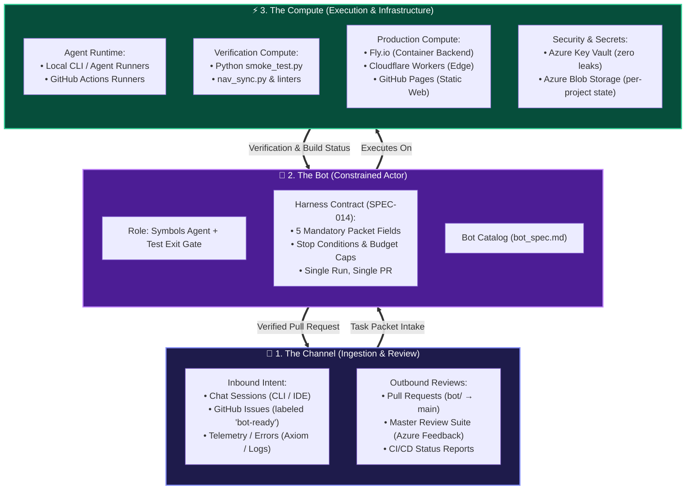

# 🤖 AI Harness & The Triad (Channel, Compute, Bot) — Real Unknown (How)

> **Stage 1: Real Unknown / How** — Architectural definition of how the Delivery Pilot Template serves as the foundation for the AI Harness, and how the **Channel**, **Compute**, and **Bot** relate to and operate within this project template.

---

## 📑 1. How This Project Relates to the AI Harness

The **Delivery Pilot Template** is the **operational substrate and harness operating system** for autonomous agent development.

An AI harness cannot operate reliably on a bare, unstructured repository. Without strict boundaries, autonomous agents succumb to cognitive drift, modify unpermitted files, fabricate untested code, commit sensitive secrets, and introduce breaking changes.

This template provides the AI harness with:
1. **The 7-Stage Mental Model**: A rigid, repeatable progression from unknown problems (`1_Real_Unknown/`) to proven solutions (`7_Testing_Known/`).
2. **The Harness Contract (`SPEC-014`)**: A machine-runnable protocol where one bot run consumes **one task packet** and produces **one pull request**.
3. **The Single Verifier Gate**: A deterministic, non-negotiable exit command (`python3 5_Symbols/toolbox/smoke_test.py`) that gates all pull requests and CI/CD deployments.
4. **Institutional Memory**: Closed-loop tracking where failures in `6_Semblance/` and reasoning in `4_Formula/llm_thinking_log.md` persist across agent restarts and LLM model switches.

---

## 🔺 2. The Harness Triad: Channel, Compute, and Bot

The AI Harness architecture is defined by three interconnected pillars: **Channel**, **Compute**, and **Bot**. The Delivery Pilot Template formally defines and bounds each component:



---

## 📡 3. The Channel (Ingestion, Communication & Review)

The **Channel** is the transport layer through which human intent, machine events, and review feedback enter and exit the template.

### Inbound Channels (Task Intake)
- **Interactive Chat Channel**: Used by developers steering agents in real-time (Antigravity CLI, Claude Code, Cursor, Copilot). Guided by `agents.md` standing rules (confirmation before implementation, `RULE-002` commit/push).
- **Issue Intake Channel (`bot-ready`)**: Asynchronous GitHub Issues labeled `bot-ready` containing the 5 mandatory task packet fields. Bots poll or trigger via webhook from this channel.
- **Telemetry Event Channel**: Automated triggers, such as nightly cron schedules or Axiom backend error logs (`4_Formula/logging_and_autofix.md`), which construct automated repair packets from runtime scars.

### Outbound Channels (Feedback & Delivery)
- **Pull Request Channel**: The bot delivers output as an isolated pull request (`bot/<task-id>` → `main`). The PR body contains the mandatory 5-line harness contract verified by CI (`.github/workflows/harness.yml`).
- **Master Review & Feedback Channel (`5_Symbols/deliverypilot/master_review/`)**: In-browser inspection suite where humans review every repository artifact and persist notes to project-scoped Azure Blob Storage (`SPEC-017`).

---

## ⚡ 4. The Compute (Runtime, Infrastructure & Storage)

The **Compute** is the physical and cloud infrastructure that powers agent execution, verification, and delivered applications.

### 1. Agent & Runner Compute
- **Local Runner**: The developer's workstation CPU/RAM executing the agentic process and CLI scripts.
- **Detached CI Runner**: GitHub Actions virtual machines executing headless automated tasks, test suites, and nightly autofix routines.

### 2. Verification Compute
- Lightweight Python runtime executing deterministic local gates:
  - `python3 5_Symbols/toolbox/smoke_test.py`: Fast 11-point structural and link validation.
  - `python3 5_Symbols/toolbox/nav_sync.py`: 3-way navigation synchronization.
  - `python3 5_Symbols/toolbox/gen_repo_files.py`: Artifact catalog generation.

### 3. Production & Hosting Compute
- **GitHub Pages**: Static hosting for the project web client and markdown renderer.
- **Fly.io**: Persistent containerized edge compute for heavy Python services and long-running APIs (`RULE-003`).
- **Cloudflare Workers**: Serverless edge compute for routing, auth, and fast proxying.

### 4. Security & Storage Compute
- **Azure Key Vault**: Centralized enterprise secrets management (`/vaults/dp-kv-deliverypilot/secrets`). No secrets ever touch git or compute disk.
- **Azure Blob Storage**: Isolated per-project cloud containers (`{{PROJECT_NAME}}`) housing review states and feedback data.

---

## 🤖 5. The Bot (The Autonomous Actor)

The **Bot** is the autonomous software entity operating inside the harness, cataloged and governed by the template.

### Architectural Definition
- **Not an Unbounded Agent**: The bot is strictly instantiated as a **Symbols Agent with a Test Agent exit gate**.
- **Cataloged in Formula**: Every bot implemented or instantiated in a project has a dedicated specification in `4_Formula/bot_spec.md` (or `4_Formula/bot_spec_<agent>.md`), detailing its display name, agent ID, allowed data sources, and operating rules.
- **The Task Packet Contract (`SPEC-014`)**:
  The bot is fed a strictly validated task packet:
  ```markdown
  - id: TSK-NNN
  - outcome: [Single sentence defining completion]
  - allowed paths: [Whitelist of files/directories the bot may touch]
  - forbidden paths: [main branch, .env, Key Vault secrets, unrelated stages]
  - verifier: python3 5_Symbols/toolbox/smoke_test.py
  - spec id: [SPEC-XXX, if specification changes are permitted]
  ```
- **The Refusal Rule**: If any of the 5 fields is missing or invalid, the bot **refuses to start** (`5_Symbols/toolbox/harness_packet.py`).
- **Single-Run Lifecycle**:
  ```text
  Clean checkout → Branch bot/<task-id> → Plan in llm_thinking_log.md → 
  Edit allowed paths only → Run verifier → Formulate spec (RULE-001) → 
  Open single PR → Stop (Human merges)
  ```

---

## 🔄 6. How the Template Binds Channel, Compute, and Bot

The Delivery Pilot Template acts as the contract that binds the triad into a self-learning cycle:

| Triad Element | Template Stage Mapping | Governance Mechanism |
|---|---|---|
| **Channel** | `1_Real_Unknown/` & `6_Semblance/` | `tasks.md` packets, `prompts.md`, Master Review in Azure, PR bodies |
| **Compute** | `2_Environment/` & `5_Symbols/toolbox/` | `architecture.md`, `setup_*.md`, `smoke_test.py`, Key Vault, Fly.io |
| **Bot** | `4_Formula/` & `5_Symbols/` | `harness.md`, `bot_spec.md`, `specs.md` (`SPEC-014`, `SPEC-015`), `agent_operating_rules.md` |

By embedding the harness triad into the repository structure, any consumer project bootstrapping from this template inherits a production-grade, secure, and fully autonomous development pipeline.
