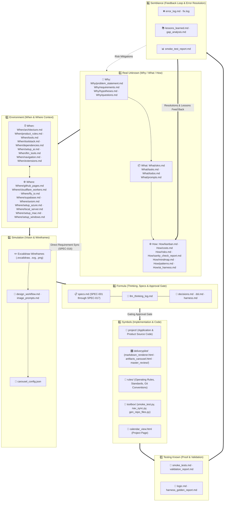

# 🧠 Mindmap & Architectural File Lineage — Real Unknown (How)

> **Stage 1: Real Unknown / How** — Comprehensive mindmap visualizing how all files connect across the 7-stage self-learning framework, including dependency lineage and architectural rationale.

---

## 🗺️ Framework Lineage Mindmap

---

## 🔗 File Connection Matrix & Rationale

| Stage & Category | Primary Files | Upstream Inputs (Feeds From) | Downstream Deliverables (Feeds To) | Architectural Rationale |
|---|---|---|---|---|
| **1️⃣ Real Unknown: Why** | `Why/problem_statement.md` `Why/requirements.md` `Why/hypotheses.md` `Why/questions.md` | Customer pain, user prompts, market gaps | `1_Real_Unknown/What/okrs.md` `3_Simulation/` (Wireframes) `4_Formula/specs.md` | Grounds the entire project in actual need. Prevents building solutions for unverified or ill-defined problems. |
| **1️⃣ Real Unknown: What** | `What/okrs.md` `What/tasks.md` `What/todos.md` `What/prompts.md` | Problem statements & functional requirements | `1_Real_Unknown/How/kanban.md` All stage agents | Quantifies success metrics and organizes tasks into multi-agent coordinated phases. Logs all input prompts for complete auditability. |
| **1️⃣ Real Unknown: How** | `How/kanban.md` `How/costs.md` `How/risks.md` `How/sanity_check_report.md` `How/mindmap.md` `How/patterns.md` `How/ai_harness.md` | Phase tracking, cloud spend, error feedback | `2_Environment/architecture.md` Real Agent Coordinator | Tracks workflow velocity, monitors resource spend, registers active/mitigated risks, and documents structural lineage, architectural patterns & AI harness triad. |
| **2️⃣ Environment** | `When/` (architecture, tools, extensions) `Where/` (fly_io, cloudflare, azure, local) | `1_Real_Unknown/` requirements & constraints | `3_Simulation/` `4_Formula/` Developer environment | Establishes infrastructure, toolstack rationale, IDE extensions (Excalidraw, Mermaid, Markdown Preview), and zero-secret Azure Key Vault policies partitioned across temporal When rules and spatial Where environments. |
| **3️⃣ Simulation** | `feature_wireframe.excalidraw` `design_workflow.md` `carousel_config.json` | `1_Real_Unknown` problems & OKRs | `4_Formula/specs.md` (SPEC-016 Gate) `index.html` carousel | "Make the invisible visible before writing code". Excalidraw wireframes translate problems into visual workflows, keeping design and specs in strict sync. |
| **4️⃣ Formula** | `specs.md` `decisions.md` `llm_thinking_log.md` `harness.md` | `3_Simulation/` wireframes & `2_Environment/` tools | `5_Symbols/` implementation gate | Mandatory thinking & planning gate. Specs define behavior before coding, and post-delivery formulation ensures specifications reflect reality (RULE-001). |
| **5️⃣ Symbols: project/** | Application source code, APIs, backend services | `4_Formula/specs.md` `5_Symbols/rules/` | `7_Testing_Known/` | Houses product-specific implementation, cleanly decoupled from the underlying delivery-pilot framework. |
| **5️⃣ Symbols: deliverypilot/** | `master_review/` (app.js, styles.css, index.html, repo_files.json) | Framework tooling requirements | Project auditing & Azure feedback | Provides an in-browser inspection carousel across all files with isolated per-project Azure Blob Storage containers (SPEC-017). |
| **5️⃣ Symbols: rules & toolbox** | `rules/agent_operating_rules.md` `toolbox/smoke_test.py` `toolbox/nav_sync.py` | Framework standing orders | All agents & CI/CD pipeline | Enforces RULE-001 (spec what you did), RULE-002 (commit & push), automated 3-way navigation synchronization, and root layout integrity. |
| **7️⃣ Testing Known** | `smoke_tests.md` `validation_report.md` `logic.md` | `5_Symbols/` code outputs | `6_Semblance/` | Runs smoke suites, tests hypotheses from Stage 1, evaluates premise-to-conclusion chains, and verifies local/deployed environments. |
| **6️⃣ Semblance** | `error_log.md` `fix.log` `lessons_learned.md` `smoke_test_report.md` | Failures detected in `7_Testing_Known` | Feedback loop back to `1_Real_Unknown/risks.md` | Resolves errors completely via test/fix synthesis before handoff. Lessons learned and resolved mitigations feed directly back into Stage 1 to evolve the system. |

---

## 🎯 Key Architectural Principles Demonstrated

1. **Why ➔ How ➔ What Golden Circle Split (`1_Real_Unknown/`)**:
   Separates *why* we build (problems/hypotheses) from *how* we govern (risks/costs/mindmaps) and *what* we deliver (OKRs/tasks/todos).
2. **Design-First Excalidraw Synchronization (`SPEC-016`)**:
   Excalidraw wireframes in `3_Simulation/` bridge the gap between `1_Real_Unknown/` and `4_Formula/specs.md`, ensuring code is never implemented from obsolete visual assumptions.
3. **Subfolder Decoupling in `5_Symbols/`**:
   `project/` contains consumer application code, while `deliverypilot/` houses framework-level review suites and tooling, eliminating cross-contamination.
4. **Closed-Loop Feedback**:
   Errors logged in `6_Semblance/` are resolved and fed back to `1_Real_Unknown/risks.md` and `tasks.md`, turning failures into institutional memory.
