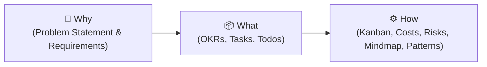

# 📐 Architectural Patterns — Real Unknown (How)

> **Stage 1: Real Unknown / How** — Core architectural design patterns, conventions, and structural idioms powering the Delivery Pilot Template framework.

---

## 📑 Overview

Patterns provide repeatable, predictable architectural solutions across the delivery lifecycle. In the Project Self-Learning System, conventions remove cognitive friction so agents and human developers immediately understand where code, specs, feedback, and documentation live.

---

## 📌 Pattern 1: Pinned Leading Underscore Directory Overview (`_README.md`)

### The Challenge
In large multi-stage projects containing dozens of files per folder, standard `README.md` files sort alphabetically in the middle of directories (e.g., after `prompts.md` and before `tasks.md`), requiring users and agents to hunt for the stage overview.

### The Solution: `_README.md`
All stage folders and primary subdirectories prefix their overview document with a leading underscore:

```text
1_Real_Unknown/
├── _README.md                <-- 📌 Always sorted to the top!
├── costs.md
├── hypotheses.md
├── kanban.md
├── okrs.md
├── problem_statement.md
├── prompts.md
├── questions.md
├── requirements.md
├── risks.md
├── tasks.md
└── todos.md
```

### Key Benefits
1. **Alphabetical Sorting Priority**:
   In Unix/Linux file systems, VS Code, JetBrains, terminal `ls`, and GitHub file explorers, the underscore character (`_`, ASCII 95) sorts ahead of lowercase letters (`a-z`), guaranteeing that `_README.md` is always pinned at the very top of directory listings.
2. **Visual Separation of Metadata vs Content**:
   The underscore clearly distinguishes stage metadata/entry-point guides from domain-specific deliverable files (e.g. `_README.md` vs `specs.md` or `architecture.md`).
3. **Consistent Navigation Target**:
   Automated tools (`5_Symbols/toolbox/nav_sync.py`, `5_Symbols/markdown_renderer.html`) link to `_README.md` for all folder-level headings across the unified debug menu.
4. **Root Dual-Compatibility**:
   At the repository root, `_README.md` is the primary file for alphabetical pin placement, while a symbolic link (`README.md -> _README.md`) ensures GitHub's web repository landing page continues to render the project overview seamlessly.

---

## 🎯 Pattern 2: Golden Circle Directory Taxonomy (`Why / How / What`)

Implemented within `1_Real_Unknown/`:



- **Why**: Explains user pain, market reality, and core hypotheses before defining tasks.
- **What**: Translates rationale into measurable OKRs, work breakdown structures, and quick-capture todos.
- **How**: Governs execution velocity (Kanban), financial bounds (Costs), risk registers (Risks), structural lineage (`How/mindmap.md`), and design patterns (`How/patterns.md`).

---

## 🏛️ Pattern 3: Decoupled Implementation Structure (`5_Symbols/`)

To prevent consumer application code from intermingling with framework inspection tooling, `5_Symbols/` enforces a strict two-pillar subfolder boundary:

- **`5_Symbols/project/`**: Dedicated solely to consumer application source code, API routes, components, and domain business logic.
- **`5_Symbols/deliverypilot/`**: Dedicated solely to template framework tooling, including `master_review/` (in-browser repository inspector and Azure feedback suite).

---

## 🔒 Pattern 4: Per-Project Storage Isolation

Feedback and inspection state captured via `5_Symbols/deliverypilot/master_review/` is stored in **Azure Blob Storage**:
- Every consumer project resolves its own dedicated Azure container using `{{PROJECT_NAME}}`.
- Projects never overwrite or collide with each other's review notes or check states.
- Local browser storage / cookies provide an offline fallback when Azure connectivity is unavailable.

---

## 🎨 Pattern 5: Design-First Simulation Gate (`SPEC-016`)

Code is never written in `5_Symbols/` until visual representations exist in `3_Simulation/`:
- Visual wireframes are created in **Excalidraw** (`.excalidraw` + exported `.svg`/`.png`).
- Specifications in `4_Formula/specs.md` reference wireframe elements directly.
- The Formula gate verifies design alignment before authorising code implementation.

---

## 🔄 Pattern 6: Closed-Loop Error Resolution & Self-Learning

Errors detected during testing do not merely get patched; they evolve the system:
1. `7_Testing_Known/` detects failures via smoke tests and logic evaluation.
2. `6_Semblance/` logs the incident (`error_log.md`), tests the fix (`fix.log`), and captures insights (`lessons_learned.md`).
3. Resolved outcomes and new risk factors feed directly back to `1_Real_Unknown/risks.md` and `tasks.md`, permanently closing the loop.

---

## 📋 Pattern Checklist for Stage Folders

When creating or reorganizing a stage folder in Delivery Pilot:
- [x] Create `_README.md` at folder root with stage purpose, contents table, and workflow checklist.
- [x] Register `_README.md` in `5_Symbols/toolbox/nav_sync.py`.
- [x] Run `python3 5_Symbols/toolbox/nav_sync.py` to synchronize 3-way navigation.
- [x] Run `python3 5_Symbols/toolbox/smoke_test.py` to confirm zero orphaned files or broken links.
