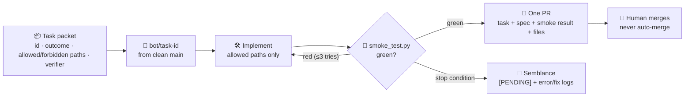

# Design Workflow — Design Before Code

> **Stage 3: Simulation** — Visual designs must be created before implementation. This file documents the design-first workflow.

## The Rule

**Before delivering any implementation (code in `5_Symbols`):**

1. Ground visual ideas in `1_Real_Unknown/` (problem statements, OKRs, user journeys)
2. Create Excalidraw wireframes (`.excalidraw` + `.svg`/`.png`) and mockups in `3_Simulation/`
3. Document specs (what the feature does) in `4_Formula/specs.md` (SPEC-016 gates code on wireframe-to-problem sync)
4. Only after designs and specs are in place, proceed to code in `5_Symbols`
5. When `1_Real_Unknown` or feature requirements change, update the Excalidraw wireframes here AND the specs in `4_Formula/`

## Design Workflow Checklist

- [ ] Check `1_Real_Unknown/` to ensure wireframe addresses documented problems and OKRs
- [ ] Create Excalidraw wireframe (`.excalidraw` and exported `.svg`/`.png`) in `3_Simulation/`
- [ ] Log the prompt/rationale used to generate designs in `image_prompts.md`
- [ ] Add the exported image to `carousel_config.json` for the auto-updating carousel
- [ ] Document the feature spec in `4_Formula/specs.md` referencing the wireframe
- [ ] Review Excalidraw wireframes against `1_Real_Unknown` and specs before coding
- [ ] Update designs when requirements evolve

## Image & Wireframe Naming Convention

```
3_Simulation/
├── feature_name_wireframe.excalidraw # Editable Excalidraw source
├── feature_name_wireframe.svg        # Scalable vector export for documentation
├── feature_name_wireframe.png        # Raster export for carousel & previews
├── feature_name_mockup.png           # High-fidelity mockup
├── feature_name_flow.png             # User flow diagram
├── feature_name_final.png            # Final approved design
└── image_prompts.md                  # All AI generation prompts
```

## Excalidraw Wireframes & 1_Real_Unknown Synchronization

Excalidraw wireframes act as the primary visual contract between the problem space and technical formulation:
- **Direct Lineage**: Every UI component, screen, or workflow sketched in Excalidraw maps back to an item in `1_Real_Unknown/` (`problem_statement.md`, `okrs.md`, or `questions.md`).
- **Continuous Sync**: If a hypothesis or OKR changes in `1_Real_Unknown/`, the Excalidraw wireframe is updated first.
- **Formula Enforcement**: As formulated in `4_Formula/` (SPEC-016), the Formula Agent validates that wireframes in `3_Simulation/` reflect the latest `1_Real_Unknown/` definitions before passing the gate to `5_Symbols/`.


## Design Guidelines

- Dark mode, glassmorphism panels, neon teal + purple accents
- No device frames — request raw UI from AI generators
- Desktop: `--ar 16:9` | Mobile: `--ar 9:16`
- Use consistent styling across all mockups
- Move obsolete designs to `_obsolete/`

## Integration with Specs

Designs here in `3_Simulation/` and specs in `4_Formula/specs.md` work together:

| Design File | Spec Reference |
|-------------|---------------|
| `feature_mockup.png` | `SPEC-XXX` in `4_Formula/specs.md` |

When a spec changes, the corresponding design should be updated. When a design is revised, check that the spec still matches.

## Harness flow (SPEC-014)

Bot-driven runs follow the packet → branch → verifier → PR → human merge flow. Mermaid source of truth (rendered wherever Mermaid is available):



Related: `4_Formula/harness.md`, SPEC-014, `1_Real_Unknown/tasks.md` Phase 8.
